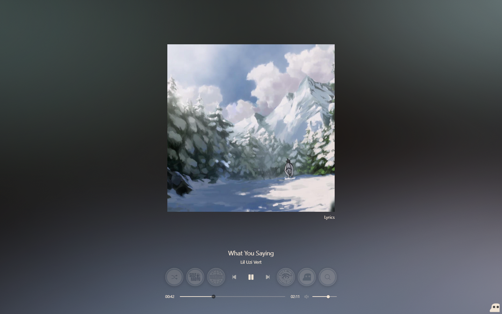
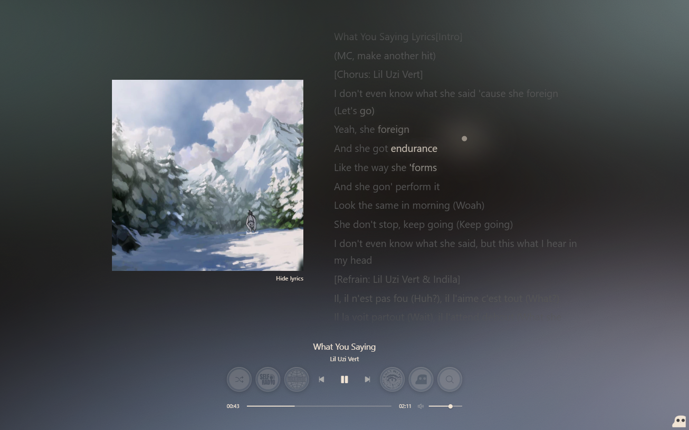
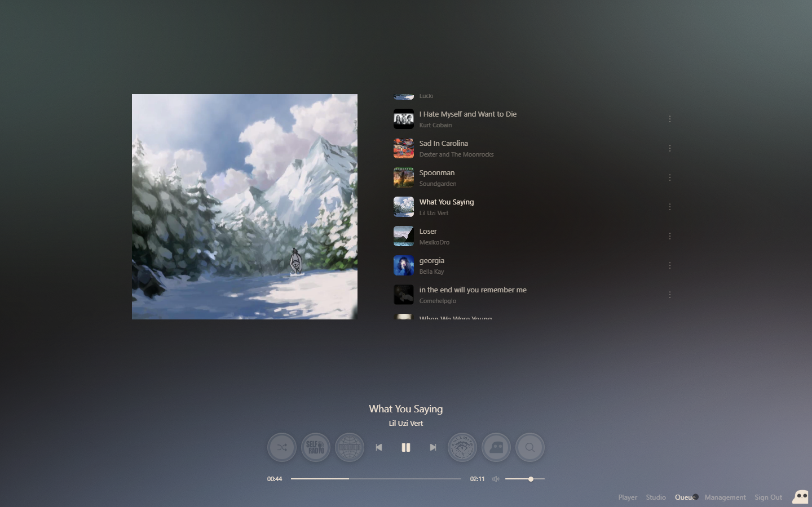
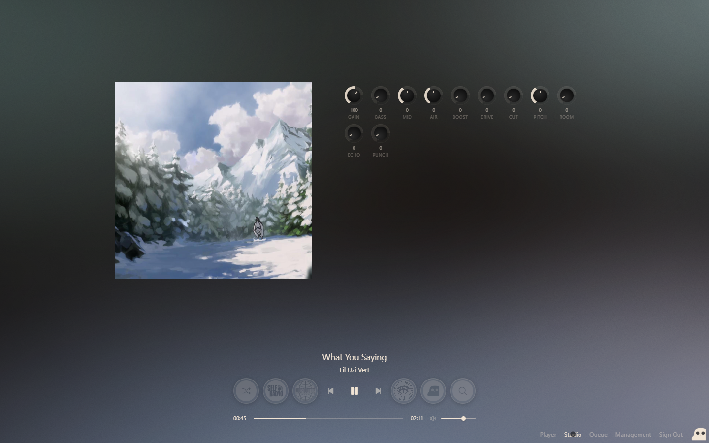

<table>
  <tr>
    <td width="88" valign="middle"></td>
    <td valign="middle">
      <h1>Motto</h1>
      <p>A music player that runs on your computer. Your songs stay in this folder. Anyone who clones the repo adds their own music.</p>
    </td>
  </tr>
  <tr>
    <td colspan="2">
      <table width="100%">
        <tr>
          <td width="25%"></td>
          <td width="25%"></td>
          <td width="25%"></td>
          <td width="25%"></td>
        </tr>
        <tr>
          <td align="center">Player</td>
          <td align="center">Lyrics</td>
          <td align="center">Queue</td>
          <td align="center">Studio</td>
        </tr>
      </table>
    </td>
  </tr>
</table>

## Run

Motto needs [Node.js](https://nodejs.org). The player has nothing else to install.

On Windows, double-click `start.bat`.

From a terminal, in this folder:

```
node server.mjs
```

Open http://localhost:8080

The first time Motto opens, it asks how you want to sign in. You can leave it open, use a PIN, or use an email and a PIN. That choice stays on this computer.

Motto only answers on this PC. Other devices on the network cannot open it.

On Windows, `stop.bat` stops the server.

## Add your music

Put audio files in the `music` folder. This layout works well:

```
music/Artist/Album/Song.mp3
```

You can also open the logo at the bottom right, choose Management, then Import, and add files, a folder, or a zip.

Motto plays mp3, flac, wav, m4a, aac, ogg, opus, and aiff.

Cover art is read from the file. If a song has none, Motto looks one up while it plays.

## Lyrics

Put a `.lrc` file next to a song and give it the same name. Motto uses that file first.

If there is no file, Motto looks the lyrics up while the song plays. The Lyrics button under the cover opens them.

## Player

Play, previous, and next sit in the bottom bar, with the timeline and volume.

Shuffle plays the library. The other four buttons are stations. In Management, put the artists you want on each station.

Search is the magnifying glass.

The logo at the bottom right opens Player, Studio, Queue, and Management.

Studio is the sound rack: gain, bass, mid, air, boost, drive, cut, pitch, room, echo, and punch.

Queue is what plays next. Drag a row to reorder it.

## What stays on your computer

These files are listed in `.gitignore`. A public copy of the repo does not include them:

- `music/`, your songs, covers, and lyric files
- `.env`, if you create one
- `config/auth.json`, your sign-in
- `config/settings.json`, your preferences
- `config/radio.json`, your stations and artist lists

If `config/radio.json` is missing, the server copies `config/radio.example.json` once and leaves it empty. A file that is already there is left alone.

Copy `.env.example` to `.env` if you want the server to know an email and PIN from a file. The first-run screen can set this up on its own.
